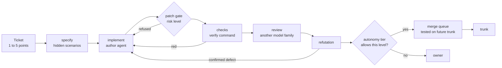

# Pheromill

A software factory: tickets go in, proven changes land on an always-green
trunk. Agents write and review the code; deterministic gates decide what
merges, and changing a gate is itself a change that takes the strictest path.

Pheromill is designed to be forge-, harness- and model-agnostic: the rules
never import an adapter, any command-line agent is plain configuration, and
one forge adapter (GitHub) exists today. It depends on no package, so there is
nothing to install from a registry; it needs Node.js, git and, for the
services, a container runtime.

> **Where it stands.** The rules, the pipeline, the merge queue, the sandbox
> hardening, the egress proxy and the model gateway are built and covered by
> automated tests. Running against a live forge with real model providers is
> built and **not yet proven**, and several loops (reference set, audits,
> debt, reports) are designed and not built.
> [docs/status.md](docs/status.md) lists every claim with its status and its
> evidence; nothing in this repository is implied beyond that page.

## The idea in one diagram



Specify, implement, review and refutation are agent steps. Everything else is
deterministic code. An agent never decides whether its own work passes.

## What makes it different

| Principle | What it means here |
| --- | --- |
| Nobody approves their own work | Reviewers and the refuter never belong to a model family that wrote the implementation. With one family configured, nothing can be approved. |
| An agent cannot cheat | Acceptance scenarios are hidden from the implementer. Touching an existing test raises the risk level and triggers a dedicated review. Rules, prompts and configuration are reserved paths. The gates judge what git says a patch does, not what the patch claims. |
| Risk decides the gates | LOW, HIGH or CRITICAL is computed from the files a change touches. Autonomy is earned one level at a time, on measured results. |
| The trunk is always green | Every change is tested on the future state of the trunk, in batches, with bisection on failure. The trunk only fast-forwards to a commit that passed. |
| Loops end | Five deterministic triggers stop a ticket that goes in circles. It is escalated once; after that the owner decides. An owner's approval is tied to one commit. |
| Secrets stay out | Each step runs in a fresh container whose only way out is a filtering proxy. Model keys never enter it: a gateway adds them outside. |
| Every choice leaves a trace | Decisions are appended to a hash-chained ledger. Costs that were not measured are reported as UNKNOWN, never estimated. |

## Try it in one minute

Requires Node.js 22.8 or newer and git 2.38 or newer. No install step.

```sh
git clone https://github.com/samimenouar/pheromill.git
cd pheromill
node bin/pheromill.js demo      # the whole pipeline with scripted agents, no key needed
node scripts/verify.js          # the command that proves a change to this repository
```

## Use it on a repository

```sh
node bin/pheromill.js init ../my-product --name my-product --repository owner/my-product
cd ../my-product
node ../pheromill/bin/pheromill.js doctor   # says exactly what is still missing
```

`init` adds the configuration file, the ticket form, the agent rules, the
holdout directory and a verify workflow. Then follow
[docs/operations.md](docs/operations.md) to add harnesses, keys and the three
services.

## Documentation

| Read | To learn |
| --- | --- |
| [docs/architecture.md](docs/architecture.md) | Zones, roles, the pipeline, ports and adapters, glossary |
| [docs/delivery.md](docs/delivery.md) | Tickets, scheduling, risk levels, the merge queue |
| [docs/quality.md](docs/quality.md) | How cheating is prevented, reviews, the reference set, debt |
| [docs/security.md](docs/security.md) | Threat model, controls, residual risk, incident runbooks |
| [docs/metrics.md](docs/metrics.md) | DORA, budgets, loop detection, autonomy tiers |
| [docs/operations.md](docs/operations.md) | Installing, configuring and running the factory |
| [docs/products.md](docs/products.md) | What the factory requires of the products it builds |
| [docs/decisions.md](docs/decisions.md) | Every design decision: why, what it brings, what it costs |
| [docs/plan.md](docs/plan.md) | The rollout plan, phase by phase, with exit criteria |
| [docs/status.md](docs/status.md) | Every claim, proven or not |

## The name

Pheromill reads as pheromone plus mill, and the design follows that image.
Ants coordinate without talking to each other: each one reads and leaves
traces in a shared environment. Here, agents never negotiate; they read
tickets, leave patches and reports, and the factory's ledger is the trail.

## License

[Apache License 2.0](LICENSE). See [SECURITY.md](SECURITY.md) to report a
vulnerability and [CONTRIBUTING.md](CONTRIBUTING.md) to contribute.
