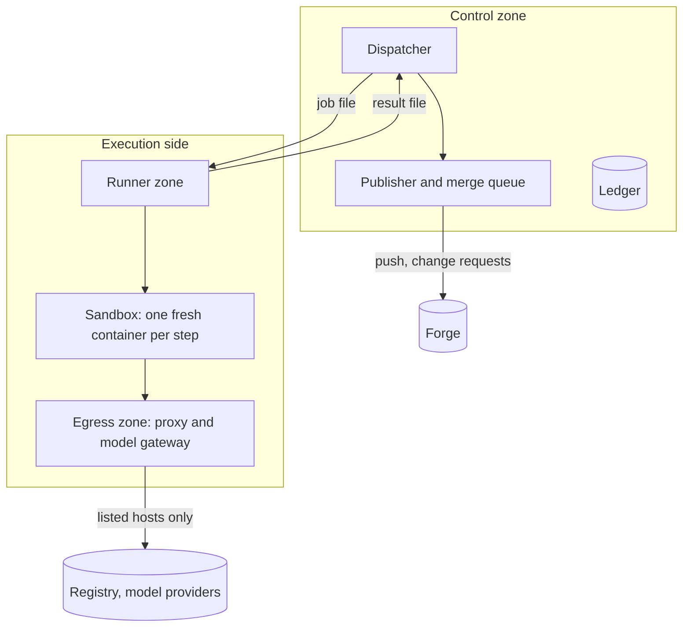

# Architecture

## Three trust zones

The factory is split so that compromising one part does not hand over the
rest. Each zone holds one kind of secret.



| Zone | Runs | Holds | Never holds |
| --- | --- | --- | --- |
| Control | Dispatcher, publisher, merge queue, ledger | Forge credential | Model keys, container daemon access |
| Runner | Workspace preparation, container launch | Container daemon access | Forge write credential, model keys |
| Egress | Egress proxy, model gateway | Model provider keys | Forge write credential, container daemon access |
| Sandbox | One agent step | A token valid for that step | Everything else |

Work crosses between the control zone and the runner as files in a spool
directory: a job goes one way, a patch and a report come back as text. The
control zone treats both as untrusted data. It applies the patch in a private
index, asks git what the patch really changes, and runs the gates on that
answer. A sandbox that is broken out of therefore gains no right to write to
the repository.

The runner and the egress service also share the directory of step tokens and
the internal network the sandboxes join.

The deployment files target one host, where the zones are separate processes
only: the runner's access to the container daemon is equivalent to root on
that host. Real separation needs the runner and egress on a second machine,
which is planned (see [security.md](security.md)).

## Roles

A role decides what a step can reach. A step has exactly one.

| Role | Steps | Workspace | Network |
| --- | --- | --- | --- |
| Author | specify, implement | Writable | Hosts listed for authors (typically the package registry), and its model through the gateway |
| Reviewer | review, security review, test guard review, refute, arbitrate | Read-only, plus the change as a diff | Its model only |
| Reader (planned) | read | None | A fixed list of documentation hosts |

The reader role exists in the network policy and has its prompt; the step that
uses it is not in the pipeline yet.

## The pipeline

One ticket goes through a fixed sequence. Deterministic steps are code in this
repository; agent steps are prompts in `prompts/`.

| # | Step | Kind | What it does |
| --- | --- | --- | --- |
| 1 | validate | deterministic | Refuses a ticket without points, criteria or likely files, or whose form is ambiguous |
| 2 | specify | agent | Writes the hidden acceptance scenarios from the ticket alone; it may only add files |
| 3 | implement | agent | Writes the change, without access to the scenarios |
| 4 | inspect | deterministic | Applies the patch and takes git's own account of what it changes |
| 5 | patch gate | deterministic | Refuses structural tricks, changes over the size limit (scenarios included), holdout or queue-owned files, refused dependencies |
| 6 | risk | deterministic | Computes LOW, HIGH or CRITICAL from the touched paths; a change riskier than routed is sent back |
| 7 | publish | deterministic | Commits the patch on a branch from the control zone |
| 8 | checks | deterministic | Waits for the project's verify command, hidden scenarios included |
| 9 | review | agent | A family that did not write the implementation looks for defects and checks each criterion |
| 10 | refute | agent | A family that did not write the implementation tries to disprove each finding; only an explicit refutation drops one, and a finding that comes back afterwards goes to the arbiter |
| 11 | decide | deterministic | Sends back, escalates, waits for the owner's approval, or enqueues |
| 12 | merge queue | deterministic | Tests on the future trunk, lands by fast-forward |

Steps 3 to 10 repeat for at most two correction rounds, each starting from the
last attempt that passed the patch gate. Then a loop trigger fires and the
arbiter decides (see [metrics.md](metrics.md)).

Who reviews what: the specify step and the implement step run in the same
family when the routes allow it, so that another family reviews both the
scenarios and the code. With three families the reviewer wrote neither. When
the routes force the scenarios and the code into different families and no
third one exists, the scenarios are reviewed by the family that wrote them,
and the ledger says so (`scenariosReviewedByAnotherFamily: false`).

## Ports and adapters

The code follows a hexagonal layout. `pheromill check` fails on any import
that points outward.

```
src/domain        pure rules, no I/O: risk, gates, queue, budget, metrics
src/application   use cases and the ports they need: pipeline, dispatcher, queue tick
src/adapters      git, GitHub, containers, egress, files, in-memory doubles
src/cli           commands and service wiring
```

| Port | Purpose | Adapters today |
| --- | --- | --- |
| Forge | Tickets, change requests, labels, approvals | GitHub, in-memory |
| Checks | Result of the verify command on a commit | GitHub, scripted |
| Vcs | Inspect a patch, publish it, build a candidate, fast-forward | git, in-memory |
| StepRunner | Run one agent step | Spool client, sandbox runner (Docker), scripted |
| PackageRegistry | Metadata for the dependency gate | npm, static |
| Ledger | Append-only record | File, in-memory |

How agnostic the factory is, precisely:

- **Harness and model**: any command-line agent is supported through
  configuration (an image, a command, the environment variables it reads). No
  code is written per harness. No harness has been proven in a live run yet.
- **CI runner**: the verify workflow is a few lines that call one command.
- **Forge**: the rules, the pipeline and the queue never import an adapter,
  and all git operations are forge-independent. One forge adapter exists,
  GitHub; the settings-as-code module also emits GitHub's ruleset format.
  Another forge needs an adapter for the Forge and Checks ports and its own
  settings format.
- **Sandbox runtime**: Docker today, behind a launcher interface.

## Configuration is read from the trunk

The services read `pheromill.config.json` from the trunk of the repository,
never from a working copy. A change to the rules therefore takes effect only
after it was merged, and the configuration file is a reserved path: changing
it is a CRITICAL change with the strictest gates. The egress service reads it
at start and must be restarted to apply a change.

## Glossary

| Term | Meaning |
| --- | --- |
| Owner | The person accountable for the repository. On the forge, anyone allowed to label issues and change requests can mark a ticket ready or approve a change: keep that right to the people who may decide |
| Ticket | An issue filed with the ticket form: one thing a user can see or test |
| Change | The patch for one ticket, published as a change request (a pull request on GitHub) |
| Harness | A command-line coding agent (the program that drives a model) |
| Family | The vendor lineage of a model; two models of one family share blind spots |
| Route | One line of configuration: which harness and model run which step at which risk levels |
| Grade | What a route may do: C reference set only, B LOW changes, A every level |
| Level | The risk of a change: LOW, HIGH or CRITICAL |
| Tier | How much the factory may merge without a person: 0 to 3 |
| Checks | The result of the project's verify command on a commit, as reported by the forge |
| Hidden scenarios | Acceptance tests in the holdout directory, invisible to the implementing agent |
| Correction round | The author is sent back with feedback; at most two per attempt |
| Rework | The ticket goes back to the start under the same number; after two the owner decides, and relabelling it ready gives it a fresh allowance |
| Eviction | A change is removed from the merge queue and its ticket goes to rework |
| Candidate | A commit the queue builds: the trunk plus the changes ahead in the queue |
