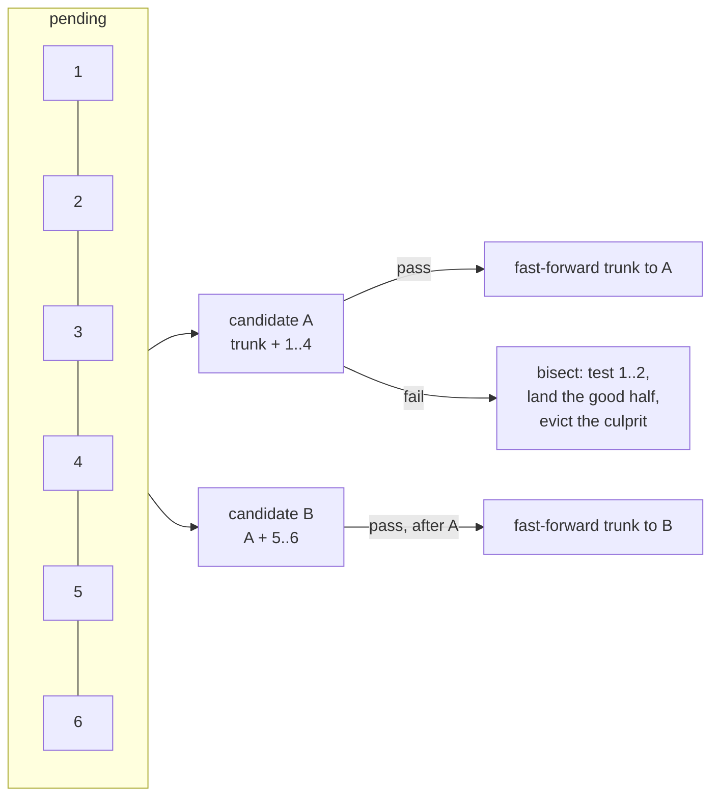

# Delivery: from ticket to trunk

The goal is to land many changes at once without conflicts, review queues or
work that goes in circles. Each rule below removes one known cause of those.

## Tickets

A ticket is one thing a user can see or test.

| Rule | Why |
| --- | --- |
| 1 to 5 points, never a micro-fix | Small findings as tickets inflate the backlog faster than it is closed. |
| Acceptance criteria are required | "Done" must be checkable by a test or by looking at the product. |
| Likely files are required | The scheduler needs them to keep colliding tickets apart. |
| Written by a trusted author, then labelled `factory:ready` | An issue is executed only if its author is the owner, a member or a collaborator, or the factory's own GitHub App (the tickets proposed by a split), and a person with triage rights labelled it. Its author can edit the text later, so the author must be trusted. |
| The form is read strictly | A body that quotes a form heading inside an answer is refused rather than guessed. |

**Done means done.** A change whose criteria are not all evidenced is sent
back; a ticket never spawns a follow-up for what it did not finish. A ticket
sent back to rework twice goes to the owner, who gives it a fresh allowance by
labelling it `factory:ready` again.

**Frozen scope.** A milestone has a short list of exit criteria. Once it is
frozen in the configuration, a ticket is worked only if it belongs to the
milestone and carries the label `blocks-exit-criterion`; everything else is
labelled `factory:later`.

**Net progress** is the indicator of a milestone: tickets closed minus tickets
created, per week. The computation exists; the weekly alert to the owner is
planned.

## Scheduling

- Two tickets whose likely files may overlap never run at the same time, and a
  change waiting in the queue or for an approval keeps its files occupied. The
  overlap test is conservative. A change is not confined to its likely files;
  if two changes collide anyway, the queue catches it as a conflict.
- At most four tickets run in parallel by default.
- One debt ticket is scheduled for every four feature tickets.

## Changes

A change is at most 500 lines, hidden scenarios included: beyond that the
patch is refused. Earlier, at 400 lines, the ticket is stopped and split into
smaller tickets that each stand on their own. Tickets proposed by a split wait for a person to label
them. A change is never trimmed to fit.

Some files attract conflicts: lock files, migration numbers, route indexes,
generated files. They are declared as queue-owned and agents cannot edit them.
Regenerating them in the queue is planned; until then they change by hand.

## Risk levels

The level is computed from the paths a change touches. No model is asked.

| Level | Trigger | Gates added |
| --- | --- | --- |
| LOW | Nothing below | Checks green, review by another family, no confirmed blocking finding |
| HIGH | A core module, a dependency manifest, a git control file (`.gitattributes`, `.gitignore`, `.gitmodules`), an existing test, a test-weakening signal, or a dependency request | Security review; test guard review when an existing test was touched |
| CRITICAL | A reserved path: configuration, pipelines, deployment, agent rules, and in this repository the factory's own source | A second independent review, from a third family when one exists |

A change the factory cannot parse with certainty is CRITICAL and refused. A
change that turns out to be riskier than its ticket was routed for is not
reviewed at the lower level: it is sent back and routed again at the right one.

Whether a level may merge without a person depends on the autonomy tier
(see [metrics.md](metrics.md)). The gates run at every tier. Below the
required tier, a change that passed every gate waits until a person adds the
label `factory:approved` to it.

An approval is tied to one commit. It counts only if the change request still
points to the commit that passed the gates; the label is removed once it is
used, and a label set earlier or on another commit is removed with a comment
that says why. A change evicted from the queue and reworked therefore needs a
new approval. To reject a waiting change instead, relabel its ticket
`factory:ready` (it is worked again) or close it: the change stops waiting and
its files are free.

## The merge queue

Changes land through the queue. The brake is on the checks, not on people.

| Property | How |
| --- | --- |
| Tested on the future trunk | A candidate is a real commit: the trunk plus the changes ahead of it. The trunk only fast-forwards to a candidate that passed, so what was tested is what lands. |
| The reviewed commit | A change is merged by the commit that passed its gates, not by whatever its branch points to later. |
| Batches | Up to four changes share one run. |
| Parallel checks | Later batches are tested at the same time, built on the earlier ones. |
| Bisection | A failed batch is halved. Halves that pass land; a change left alone is evicted to rework. |
| Flaky tolerance | A failed candidate is retried once. A pass after a failure is recorded in the ledger. |
| Conflicts | A change that conflicts with the future trunk is evicted before any run. |
| Outside moves | If the trunk moves outside the queue, candidates are rebuilt on the new head. |
| Interruptions | A tick stopped anywhere is replayed from the saved state and from what the trunk contains: each change lands, is evicted and is recorded once. |

The queue is implemented here rather than delegated to the forge, because a
forge-native queue is not available everywhere (GitHub's is limited to
organization-owned repositories) and would tie the factory to one forge.
Under the trunk ruleset, the queue needs an identity allowed to fast-forward
the trunk (`forge.queueActor`); this has not been exercised on a live forge yet.
