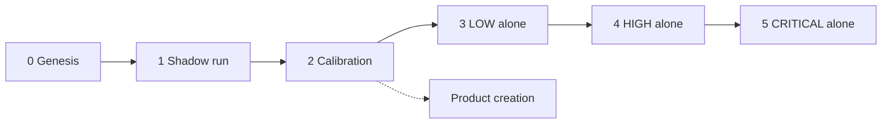

# Rollout plan

Six phases. Each has an exit criterion that can be checked, and a phase starts
only when the previous one is closed. The claims each phase must turn from
"to prove" or "planned" into "proven" are in [status.md](status.md).

## Phase 0: Genesis (the first change of this repository)

| Delivered | Exit criterion |
| --- | --- |
| The rules as tested code, the pipeline, the merge queue, sandbox, egress and gateway, GitHub and git adapters, the command line, the template, this documentation, the proof registry | `node scripts/verify.js` is green in CI, sandbox job included |

## Phase 1: Shadow run (tier 0)

The factory runs for real. Every change that passed the gates waits for the
owner's `factory:approved` label before it enters the merge queue.

| Step | Owner action needed |
| --- | --- |
| Confirm or replace the provisional choices (license, starting values) | Yes |
| Create a GitHub App for the control zone; provision one host | Yes: accounts and credentials cannot be created by the factory |
| Build the factory image and two harness images from pinned bases | No |
| Configure two harnesses from two families, a route for every step, and grades assigned by hand | Keys and grades: yes |
| Set `forge.queueActor`; apply settings as code; start the three services | An administrator token, once |
| Run the first tickets end to end on this repository | Labelling tickets, approving changes |

**Exit:** ten tickets landed through the pipeline and the queue; the claims
`services-on-a-host`, `github-live`, `queue-live`, `gateway-live`,
`settings-live`, `harness-claude-code` and `second-family` are proven; one
revocation drill is timed.

## Phase 2: Calibration

| Step | Result |
| --- | --- |
| Build the reference set and its replay command: four traps, then the first merged tickets | Routes earn grade B or A on evidence instead of by hand |
| Write the delivery log from the deployment step | DORA is computed weekly |
| Schedule the weekly jobs: debt measures, budget report, net progress, audit | The improvement loops run without intervention |
| Measure four weeks | Time and token ceilings per point are set |
| Write the promotion thresholds for tiers 1 to 3 | Fixed before any promotion |

**Exit:** four consecutive weekly reports exist; thresholds are merged; every
route in use earned its grade on the reference set.

## Phase 3: LOW changes merge alone (tier 1)

**Entry:** the tier 1 thresholds are met on measured values.
**During:** the weekly review reads everything that merged at LOW.
**Exit:** four weeks at tier 1 with change fail rate and rework rate within
the thresholds, and no confirmed finding of a gate bypass.

## Phase 4: HIGH changes merge alone (tier 2)

**Entry:** tier 2 thresholds met; mutation tests run on core modules in the
queue; the runner and egress run on a second machine; the ledger head is
anchored outside the control host.
**Exit:** as phase 3, at HIGH.

## Phase 5: CRITICAL changes merge alone (tier 3)

**Entry:** tier 3 thresholds met; a third model family is configured so that
the second independent review is from a third party; a micro-VM launcher or
an equivalent isolation is in place for the runner, with one network per run.
**Exit:** none. The thresholds keep being checked; falling below one lowers
the tier.

## Product creation (parallel, from phase 2)

The inception workflow in [products.md](products.md), reference gate scripts
for accessibility, search and performance, and the monitoring contract.
It depends on the pipeline, not the other way round.

## Problems anticipated

| Problem | Answer already in the design |
| --- | --- |
| Reviews that never end | Two correction rounds, refutation before any round, one escalation |
| Splitting that grows the backlog | Splits only by the arbiter, into tickets that stand alone; net progress is watched |
| Bug fixes that create bugs | Hidden scenarios, test protection, rework rate as a metric |
| Conflicts between parallel agents | No overlapping tickets, queue-owned files, candidates tested on the future trunk |
| Cost drifting | Budgets per ticket, UNKNOWN instead of estimates, routing to the cheapest model that passes |
| One vendor failing or regressing | Two families from the start; routes re-graded on every change |
| The factory degrading itself | Its own gates are reserved paths; it runs under its own rules |
